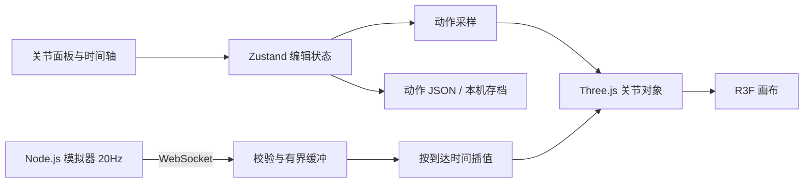

# 架构与协议

## 数据流



只有一个姿态来源在工作。编辑模式由滑块或动作采样控制；实时模式由通信缓冲控制，UI 禁止修改关节和关键帧。断开后恢复当前时间轴位置的姿态。

## 动作格式 v1

字段包括 `version`、`modelId`、`name`、`duration`、`interpolation`、`keyframes`。每个关键帧包含唯一 `id`、秒单位 `time` 和以关节名为键的 `pose`。

角度统一为弧度。支持 1–60 秒、1–200 个关键帧；当前 UI 的示例时长为 8 秒，导入文件可使用其他合法时长。相邻帧至少间隔 0.01 秒，文件不超过 2 MB。所有关节必须齐全且在限位内。

`sampleMotion` 通过二分查找定位左右关键帧。首帧之前和末帧之后保持端点姿态。新增姿态若与已有帧时间接近，则覆盖该帧；移动关键帧不允许与其他帧重合。

## WebSocket 消息

```json
{
  "type": "joint_state",
  "modelId": "rms-arm-6",
  "session": "unique-session-id",
  "seq": 1,
  "timestamp": 1791062400000,
  "joints": {
    "joint_1": 0.35,
    "joint_2": 0.6,
    "joint_3": -1.1,
    "joint_4": 0,
    "joint_5": 0.5,
    "joint_6": 0
  }
}
```

`timestamp` 是模拟器发送时的 Unix 毫秒时间，用于协议记录；显示插值使用浏览器 `performance.now()` 的到达时间，避开跨设备时钟偏差。当前没有实现时钟同步或真实网络延迟测量。

同会话内序号必须递增；连接切换时清理缓冲，最多保留 120 帧；显示延迟为 100ms。超出缓冲末尾时保持最后姿态，不外推。

WebSocket 基于有序可靠传输，但应用仍可能接收到重复序号或旧会话业务消息，因此保留序号校验。模拟器对发送积压设上限，防止慢客户端无限积累发送队列。

## 资源与渲染

模型根节点旋转 `-π/2` 绕 X 轴，将 URDF Z-up 转成场景 Y-up。轨迹和末端读数均以这个场景世界坐标为准。

模型 loader effect 独占本次解析产生的 geometry / material，卸载或重载时释放。轨迹采样 clone 只共享资源并读取变换，不进入场景、不独立 dispose。当前模型没有外部 texture；未来支持贴图时需要明确共享贴图的所有权与释放规则。

`useFrame` 直接更新三维对象。播放时钟保留在 ref，约每 50ms 发布面板状态，每 500ms 发布指标。每帧的更新不经过整棵 React 组件树。

## 依赖选择

- Next.js App Router 负责页面与构建，3D 组件通过客户端动态导入加载。
- React Three Fiber 负责 React 与 Three.js 的衔接，Drei 提供轨道控制、网格与方向辅助。
- URDF Loader 负责机器人模型解析，应用层负责动作编辑、状态与协议。
- shadcn/ui Button / Slider 使用官方注册表源码，Radix Dialog 提供学习面板的焦点管理。
- pnpm overrides 统一 `@types/three`，避免传递依赖解析到旧版本类型；同时统一 use-sync-external-store 到支持当前 React 的版本。

## 后续优先事项

为真实模型增加加载进度、错误列表、纹理生命周期；支持通用关节描述而不是固定六关节配置；补充撤销 / 重做；扩展自动化交互测试；在固定设备和模型下做可复现性能对比。
